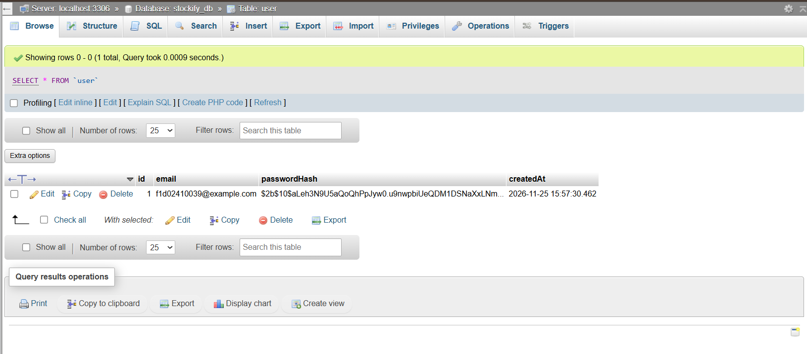
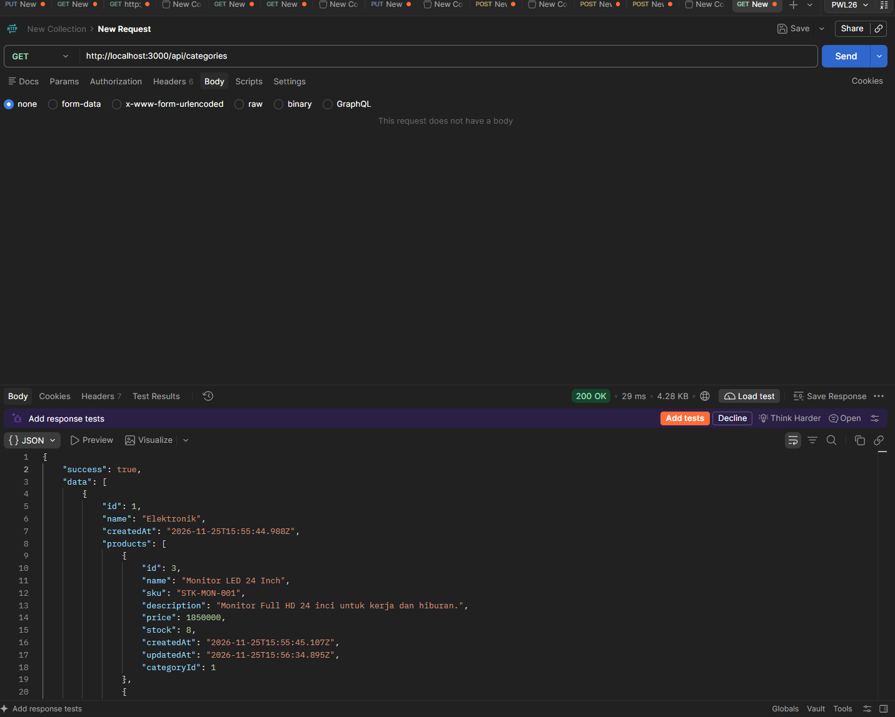
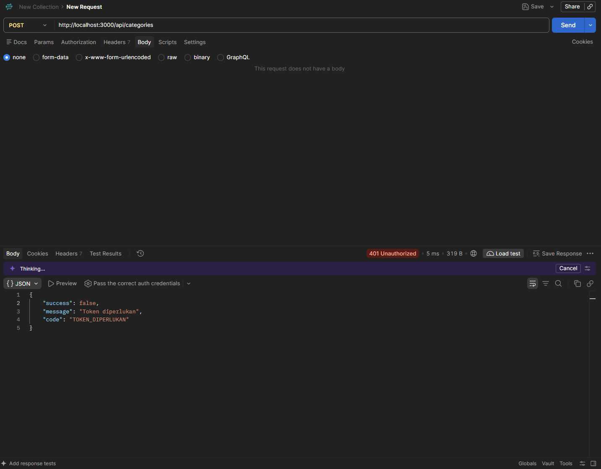
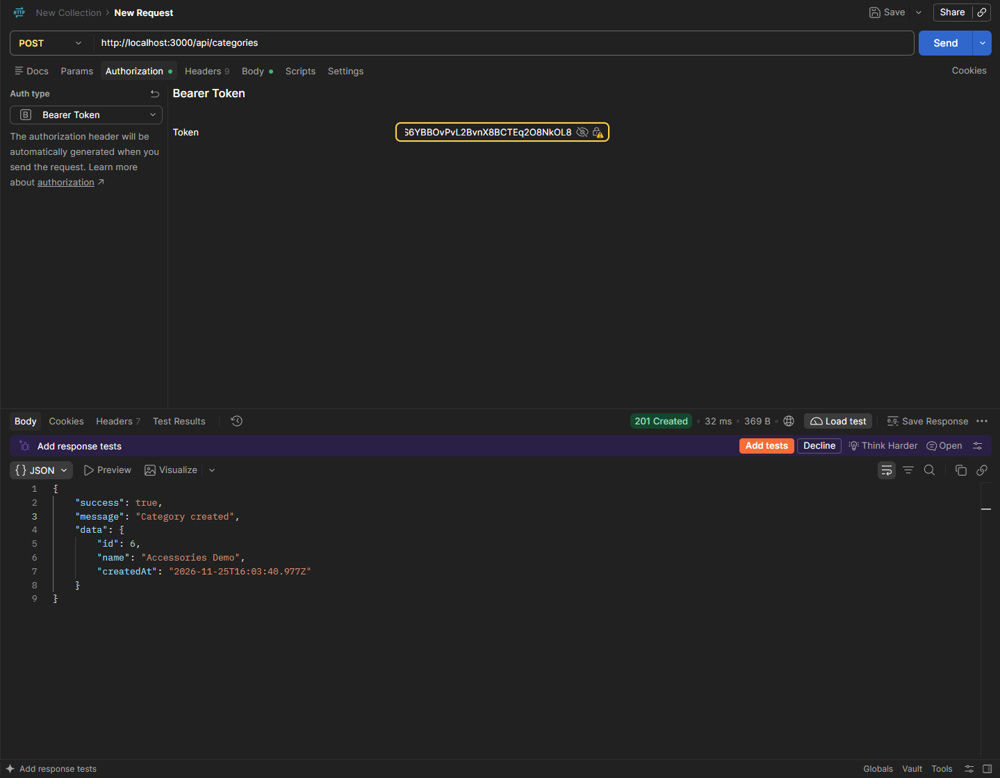
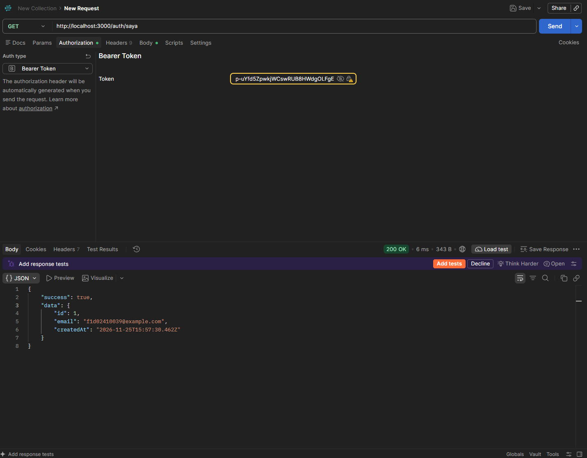
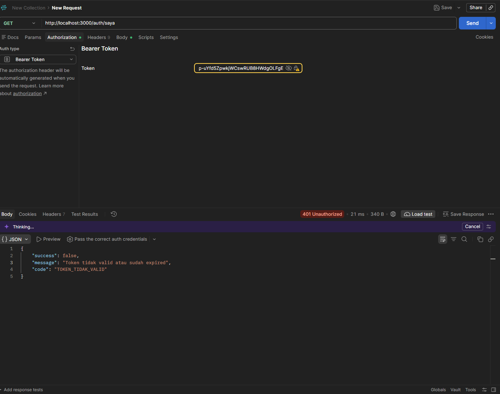
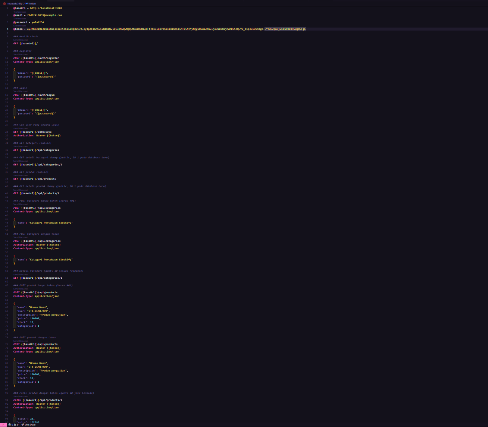

# Stockify API + Autentikasi (Tugas 9)

## Identitas

- Nama: **BAIQ ERWINA YOLANDA**
- NIM: **F1D02410039**
- Project: **Stockify Mini Project API**

## Fitur yang ditambahkan

- Register dengan password yang disimpan dalam bentuk hash bcrypt.
- Login untuk mendapatkan JWT yang berlaku selama 2 jam.
- Endpoint `/auth/saya` untuk mengecek user yang sedang login.
- Middleware `butuhLogin` untuk memeriksa Bearer token.
- Route POST, PATCH, dan DELETE kategori serta produk hanya bisa digunakan setelah login.
- Route GET tetap bisa diakses tanpa login.
- Penanganan token yang tidak ada, tidak valid, atau sudah expired.

## Teknologi

Node.js, Express, TypeScript, Prisma ORM, MySQL, bcrypt, dan JSON Web Token (JWT).

## Endpoint

| Method | Endpoint              | Akses       |
| ------ | --------------------- | ----------- |
| POST   | `/auth/register`      | Publik      |
| POST   | `/auth/login`         | Publik      |
| GET    | `/auth/saya`          | Login wajib |
| GET    | `/api/categories`     | Publik      |
| GET    | `/api/categories/:id` | Publik      |
| POST   | `/api/categories`     | Login wajib |
| PATCH  | `/api/categories/:id` | Login wajib |
| DELETE | `/api/categories/:id` | Login wajib |
| GET    | `/api/products`       | Publik      |
| GET    | `/api/products/:id`   | Publik      |
| POST   | `/api/products`       | Login wajib |
| PATCH  | `/api/products/:id`   | Login wajib |
| DELETE | `/api/products/:id`   | Login wajib |

## Menjalankan project di Windows

### 1. Buat database

Jalankan MySQL lewat Laragon atau XAMPP. Setelah itu, buat database `stockify_db` di phpMyAdmin. Bisa juga lewat SQL:

```sql
CREATE DATABASE stockify_db;
```

### 2. Buka project

Extract ZIP, lalu buka folder `stockify-ready` di VS Code. Pastikan terminal berada di folder yang berisi `package.json`.

### 3. Siapkan `.env`

Copy `.env.example`, lalu ubah nama salinannya menjadi `.env`. Sesuaikan koneksi MySQL jika username atau password kamu berbeda.

Contoh untuk MySQL lokal tanpa password:

```env
DATABASE_URL="mysql://root:@localhost:3306/stockify_db"
JWT_SECRET="ISI_SECRET_RANDOM_MINIMAL_32_KARAKTER"
PORT=3000
```

Buat secret JWT acak dari terminal:

```bash
node -p "require('node:crypto').randomBytes(32).toString('hex')"
```

Copy hasilnya ke `JWT_SECRET`. Jangan ikut meng-upload file `.env` ke GitHub.

### 4. Install package

```bash
npm install
```

### 5. Generate Prisma Client dan buat tabel

```bash
npx prisma generate
npx prisma migrate dev --name init_stockify_auth
```

Migration membuat tabel Category, Product, dan User berdasarkan schema. Kalau database kamu sudah berisi data penting, jangan melakukan reset sembarangan.

### 6. Masukkan data dummy

Agar route GET bisa menampilkan data, jalankan:

```bash
npm run db:seed
```

Seed menambahkan atau memperbarui 5 kategori dan 16 produk contoh. Prosesnya memakai `upsert`, jadi bisa dijalankan lagi tanpa membuat data seed yang sama menjadi duplikat. Seed juga menyediakan akun demo:

- Email: `f1d02410039@example.com`
- Password: `yola1234`

Akun ini bisa dipakai untuk login dan mendapatkan token. Untuk bukti register, tetap gunakan endpoint register dengan email baru.

Setelah seed, coba `GET /api/categories` dan `GET /api/products`. Data produk juga memiliki relasi kategori.

### 7. Jalankan server

```bash
npm run dev
```

Server berjalan di `http://localhost:3000`. Buka alamat tersebut di browser untuk memastikan API sudah aktif.

## Testing API lewat VS Code

Saya menggunakan extension **REST Client** dari Huachao Mao untuk menjalankan request.

1. Install REST Client di VS Code.
2. Buka `requests.http`.
3. Klik **Send Request** pada request yang ingin dicoba.
4. Jalankan Register.
5. Jalankan Login dan copy token dari response.
6. Masukkan token ke variabel `@token` di bagian atas `requests.http`.
7. Coba request yang membutuhkan token.

Akun untuk register manual:

- Email: `f1d02410039@example.com`
- Password: `yola1234`

Akun seed untuk login langsung (setelah menjalankan `npm run db:seed`):

- Email: `f1d02410039@example.com`
- Password: `yola1234`

Kalau email register sudah pernah digunakan, pakai email lain atau langsung login.

## Urutan testing

1. `GET /` untuk mengecek server.
2. Jalankan seed agar kategori dan produk dummy tersedia.
3. `GET /api/categories` dan `GET /api/products` untuk melihat data.
4. Coba detail kategori dan produk, misalnya `/api/categories/1` dan `/api/products/1` pada database baru.
5. Register user baru atau login dengan akun seed.
6. Login dan salin token.
7. `GET /auth/saya` dengan token.
8. POST kategori tanpa token, pastikan ditolak `401`.
9. Ulang POST kategori dengan token, pastikan berhasil.
10. POST produk tanpa token, pastikan ditolak `401`.
11. Ulang POST produk dengan token, pastikan berhasil.
12. Coba PATCH atau DELETE tanpa token, harus ditolak.
13. Coba login dengan password salah dan register menggunakan email duplikat.

## Bukti screenshot

Screenshot disimpan di folder `ss-t9/`. Gambar di bawah menggunakan path relatif, jadi akan tampil di GitHub selama folder dan nama file tidak diubah serta ikut di-push.

### 1. Register



### 2. GET publik



### 3. Request tanpa token



### 4. Request dengan token



### 5. Tes user / endpoint auth saya



### 6. Token dimanipulasi



### 7. Token expired


### 8. File request HTTP



## Pengujian token manipulasi

1. Login dan copy token asli.
2. Buka terminal di folder project.
3. Jalankan:

```bash
node scripts/tamper-token.js "TOKEN_ASLI"
```

4. Copy token hasil script dan masukkan ke `@token`.
5. Jalankan `/auth/saya` atau route protected.
6. Token yang diubah seharusnya ditolak dengan status `401`.

Script ini untuk demonstrasi. Payload JWT dapat dibaca, tetapi jika payload diubah tanpa signature yang sesuai, token akan ditolak saat diverifikasi.

## Pengujian token expired

1. Buka `src/service/auth.service.ts`.
2. Cari `expiresIn: "2h"` lalu sementara ubah menjadi `"5s"`.
3. Login lagi untuk mendapatkan token baru.
4. Tunggu sekitar 6–7 detik.
5. Jalankan `GET /auth/saya`.
6. Response seharusnya `401` karena token sudah expired.
7. Setelah selesai, **kembalikan `expiresIn` menjadi `"2h"`**.

## Deklarasi penggunaan AI

AI saya gunakan sebagai alat bantu saat memahami struktur project, mencari ide perbaikan ketika menemui error, serta membantu menyusun beberapa bagian dokumentasi dan skenario pengujian. Saya juga menjalankan project, mencoba request, memeriksa response, dan menyesuaikan hasilnya selama pengerjaan.

## Kesimpulan

Setelah penambahan autentikasi, route Stockify yang membaca data masih bisa diakses secara publik, sedangkan route yang membuat, mengubah, atau menghapus data memerlukan token. Password disimpan dalam bentuk hash bcrypt dan JWT digunakan untuk mengenali user pada route yang dilindungi. Pengujian dilakukan dengan token valid, tanpa token, token yang dimanipulasi, serta token expired.

## File tambahan

- `requests.http`: kumpulan request untuk mencoba endpoint.
- `scripts/tamper-token.js`: script untuk membuat token manipulasi.
- `ss-t9/`: folder bukti screenshot.
- `src/controller`, `src/service`, `src/routes`, `src/data`: pemisahan bagian API.
